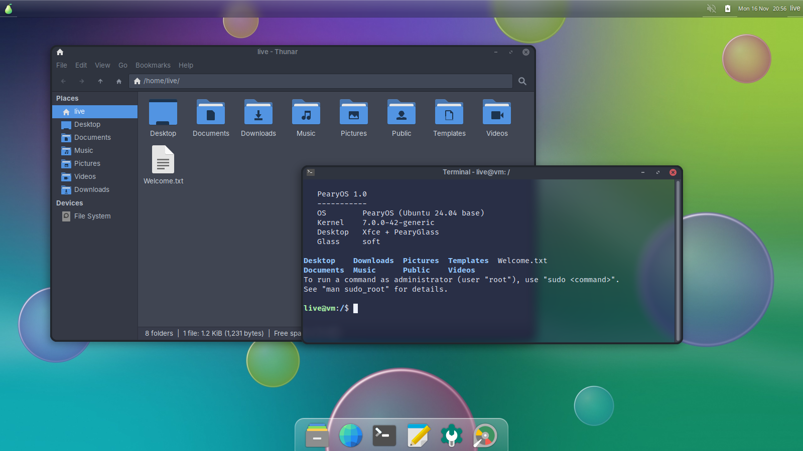
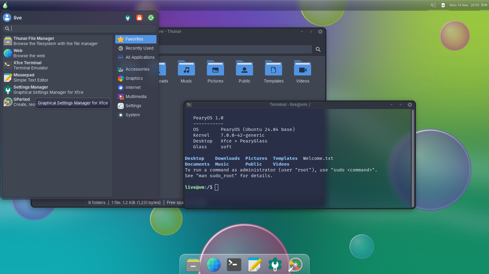

# PearyOS

**A glass-style desktop for your PC, on a USB stick.**
PearyOS is a live Linux system (Ubuntu 24.04 packages with the Xfce desktop) that has a translucent "liquid glass" look:
a frosted-glass top bar, a glass dock at the bottom that works as your taskbar, blurred translucent menus and terminals,
rounded windows and soft shadows. It boots on UEFI computers (Secure Boot too) and comes with Ethernet, Wi-Fi and Bluetooth support.





*Screenshots taken in a software-rendered X server (the `soft` glass mode described below).*

## What you get

- **Glass desktop**: translucent top bar (app menu, network, sound, power, clock), a glass dock with pinned apps and every open window (your taskbar), frosted blur behind menus, the dock and the terminal, rounded windows, soft shadows, an original pear logo and a glass-bubble wallpaper.
- **UEFI boot**: a hybrid ISO that boots on UEFI machines, from a USB stick or a virtual DVD. It uses Ubuntu's signed boot chain, so it also starts with Secure Boot turned on.
- **Network out of the box**: wired Ethernet connects by itself (DHCP); Wi-Fi and Bluetooth are included. Drivers and firmware come from Ubuntu's newest hardware-enablement kernel (Linux 7.0) and the `linux-firmware` package.
- **Apps**: Thunar (files), Epiphany (web browser), Terminal, Mousepad (text editor), Ristretto (images), File Roller (archives), GParted (disks), plus the Xfce settings tools.
- **Live session**: you are logged in as `live` (no password, `sudo` works without one). Nothing is installed to your disk, and everything you change is gone when you power off.

## Download

GitHub does not allow single files this big in a normal repository, so the ISO (about 1.3 GB) is cut into 29 parts on the [`iso-download`](../../tree/iso-download) branch.

1. Open the [`iso-download` branch](../../tree/iso-download), click the green **Code** button, then **Download ZIP** (about 1.3 GB).
2. Unzip it. On Windows double-click `join.bat`; on macOS or Linux run `sh join.sh`.
3. You now have `pearyos-1.0-amd64.iso`. Its SHA-256 must be:

```
c41bf5ce6076edfdf7c9a92bc6c3de72dad9ffd4b1a53440a380b181b7b76da1
```

## Put it on a USB stick and boot it

1. Use a USB stick of 4 GB or more. **Writing the ISO erases the stick.**
2. Write the ISO with [Rufus](https://rufus.ie) (choose **DD Image mode** when it asks) or [balenaEtcher](https://etcher.balena.io), or on Linux with `sudo dd if=pearyos-1.0-amd64.iso of=/dev/sdX bs=4M status=progress conv=fsync`.
3. Restart the computer and open its boot menu (usually F12, F10, F9, Esc or F2). Pick the USB stick's **UEFI** entry, then **PearyOS (live session)**.
4. Screen stays black? Restart and pick **safe graphics**. Desktop feels slow? Pick **glass effects off**.
5. In Hyper-V (Generation 2), either turn Secure Boot off or pick the *Microsoft UEFI Certificate Authority* Secure Boot template, otherwise it will not start.

The ISO also boots in virtual machines that use UEFI (QEMU/KVM with OVMF, VirtualBox with "Enable EFI", VMware with UEFI firmware).

## Using PearyOS

- The **pear button** (top left) opens the app menu. The **dock** at the bottom is the taskbar: it shows your pinned apps and every window that is open; click an icon to open or switch to it.
- The top bar's right side has the network, Bluetooth, sound and power indicators and the clock. For Wi-Fi click the network icon.
- Having network or boot trouble? Open a terminal and run `pearyos-diag`.
- Need more software? `sudo apt update && sudo apt install <package>` (needs internet).

## Glass effects

PearyOS picks the best mode for your machine at login:

| Mode | When | What you see |
|------|------|--------------|
| `full` | A real GPU with OpenGL | Frosted blur, translucency, soft shadows, rounded windows |
| `soft` | OpenGL on a software renderer (a VM without 3D acceleration) | The same look with a lighter blur, to save CPU |
| `lite` | No OpenGL, or a slow emulated machine | Translucency, soft shadows and rounded windows, but no blur |
| `off` | You choose it | Plain opaque desktop |

To force a mode, open a terminal and run `mkdir -p ~/.config/pearyos && echo full > ~/.config/pearyos/glass-mode` (use `full`, `soft`, `lite`, `off` or `auto`), then log out and back in. You can also pick a mode at boot: press **e** on the boot menu entry and add `pearyos.glass=full` (or `soft`, `lite`, `off`) to the line that starts with `linux`.

## What has been tested

- Booted in a virtual UEFI machine (QEMU with OVMF), once with Secure Boot on from a virtual USB stick and once with Secure Boot off from a virtual DVD: GRUB menu, desktop, automatic DHCP on a virtual Intel Ethernet card, internet access, top bar and dock all start.
- The glass effects (`soft` mode with real OpenGL blur) were rendered and checked in a software-rendered X server; the virtual machine runs `lite` because it is a slow emulated machine.
- **Not tested on real hardware yet.** If something does not work on your computer, please [open an issue](../../issues) and say which computer and which step failed (running `pearyos-diag` and pasting the output helps a lot).

## Known limits

- "Liquid glass" here means translucency, blur, light edges and rounded shapes. It does not bend light the way Apple's version does.
- It is a **live system without an installer** for now. GParted is included, but installing PearyOS to a disk is not supported yet.
- NVIDIA's proprietary driver is not included; the open-source driver is used instead. Not every Wi-Fi adapter has firmware in `linux-firmware`.
- PearyOS is built from Ubuntu packages but is **not** an official Ubuntu flavour and is not affiliated with or endorsed by Canonical, Apple or the Xfce project. "Liquid Glass" is Apple's name for its own design language; PearyOS only imitates the general look, with its own artwork.

## Build it yourself

On an Ubuntu 24.04 machine (as root, about 12 GB of free disk space):

```sh
apt install debootstrap squashfs-tools xorriso mtools dosfstools grub-common grub-efi-amd64-signed shim-signed python3-pil python3-numpy librsvg2-bin
git clone <this repository> && cd PearyOS
sudo ./build.sh        # writes work/out/pearyos-1.0-amd64.iso
sudo apt install qemu-system-x86 ovmf     # optional: scripts/04-qemu.sh boots the ISO in a UEFI VM
```

`scripts/` has the steps (bootstrap, install, ISO), `overlay/` holds the configuration files that make PearyOS look and behave the way it does, `boot/` the GRUB menu and `assets/` the logo.

## Credits and licences

PearyOS is a remix of free software: Ubuntu 24.04, the Xfce desktop, Plank, picom, the Arc theme, Papirus icons, the Inter and Fira Code fonts and many more. Each part is under its own licence; `pearyos-1.0-amd64.manifest.txt` on the [`iso-download`](../../tree/iso-download) branch lists every package in the image, and the source for all of them is in the Ubuntu archive (https://archive.ubuntu.com/ubuntu, `deb-src`). The pear logo and the wallpaper are original artwork created for this project.
